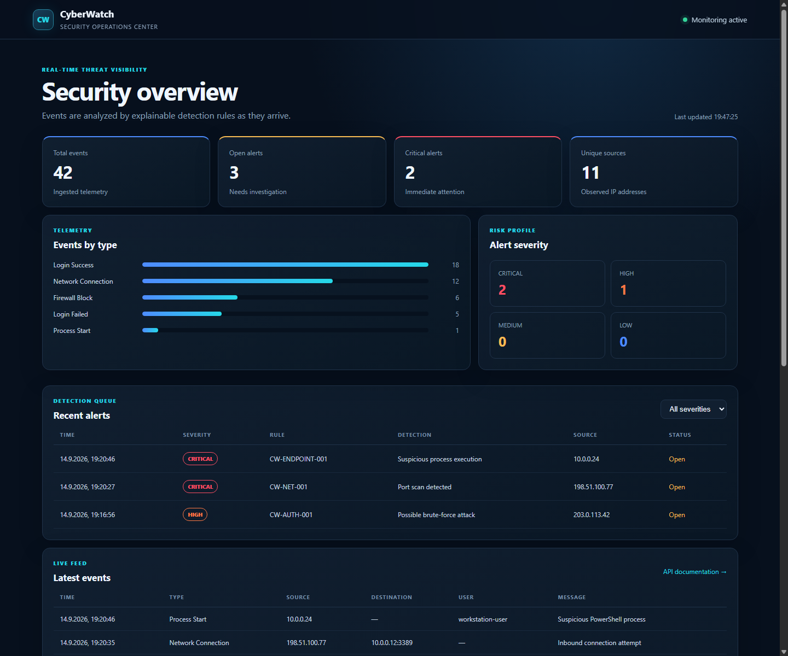
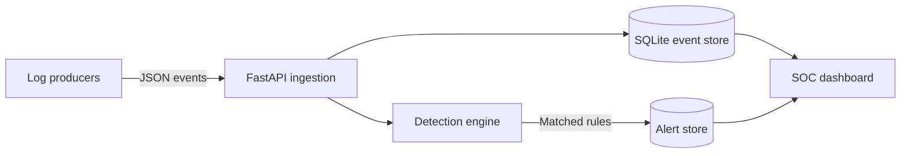

# CyberWatch Mini-SIEM

CyberWatch is a lightweight security monitoring platform that ingests structured events,
applies explainable detection rules, creates alerts, and presents the result in a responsive
SOC dashboard. It was built as a portfolio project to demonstrate Python backend engineering,
security fundamentals, API design, testing, and deployment practices.



## Highlights

- FastAPI REST API with automatic OpenAPI documentation
- Real-time, rule-based detection for brute force, port scanning, and suspicious processes
- SQLite persistence with indexed, parameterized queries
- API-key protection for ingestion and alert-triage operations
- Responsive SOC dashboard with event and severity visualizations
- Batch event ingestion and alert deduplication cooldowns
- Synthetic demo-data generator (no real attack traffic required)
- Automated tests, linting, Docker image, health checks, and GitHub Actions CI

## Architecture



The detection engine intentionally uses transparent rules rather than a black-box score. Each
alert includes a rule ID, evidence, source, severity, and human-readable explanation.

## Detection rules

| Rule ID | Detection | Trigger | Severity |
| --- | --- | --- | --- |
| `CW-AUTH-001` | Brute-force attempt | 5 failed logins from one IP in 5 minutes | High |
| `CW-NET-001` | Port scan | 10 distinct destination ports from one IP in 2 minutes | Critical |
| `CW-ENDPOINT-001` | Suspicious process | Command line matches risky script-execution indicators | Critical |

Repeated alerts for the same rule and source are suppressed for ten minutes to reduce analyst
fatigue.

## Quick start

### Windows: one click

Install Python 3.11+ with the Python launcher or **Add Python to PATH**, then double-click
[`start_windows.bat`](start_windows.bat). It creates `.venv` if needed, installs the project
and development tools, seeds an empty database, and serves <http://localhost:8000>.
Internet access is required to install dependencies. Keep the console open; press Ctrl+C to stop.
If setup fails, the console stays open with the error. Existing environment variables are respected.
If port 8000 is busy, set `CYBERWATCH_PORT` to another port before running the launcher.

Demo generation is atomic and only runs when the database has no events. Running it again,
including two concurrent launches, preserves existing events and alerts instead of adding
another 42 events. It does not delete duplicates that were already present.

### Local Python setup

```bash
python -m venv .venv
```

Activate the virtual environment:

```bash
# Windows PowerShell
.venv\Scripts\Activate.ps1

# macOS/Linux
source .venv/bin/activate
```

Install and run:

```bash
pip install -e ".[dev]"
python -m scripts.generate_demo_data
uvicorn app.main:app --reload
```

Open:

- Dashboard: <http://localhost:8000>
- API docs: <http://localhost:8000/docs>
- Health check: <http://localhost:8000/api/health>

### Docker

```bash
export CYBERWATCH_API_KEY="replace-with-a-long-random-value"
docker compose up --build
```

On Windows PowerShell, set the variable with:

```powershell
$env:CYBERWATCH_API_KEY="replace-with-a-long-random-value"
docker compose up --build
```

### Render

[`render.yaml`](render.yaml) defines a Python web service with a generated API key,
`/api/health` health check, and a 1 GB persistent disk for SQLite. It uses a **paid**
`0.5c-512mb` service because persistent disks are unavailable on free services.
See Render's [Blueprint reference](https://render.com/docs/blueprint-spec) and
[persistent disk documentation](https://render.com/docs/disks).

After approving and pushing the repository, create a Blueprint in Render and select this
repository. Review the cost before deploying. Demo data is seeded on the first start only;
restarts preserve the database. Automatic deploys are disabled. The generated
`CYBERWATCH_API_KEY` is available in Render's environment settings for ingestion requests.
The dashboard uses same-origin requests; set `CYBERWATCH_ALLOWED_ORIGINS` only if a separate
frontend needs access. The dashboard and read APIs are public, so use synthetic data for
a public portfolio deployment.

## Ingest an event

The development API key is `dev-key-change-me`. It must be overridden in production.

```bash
curl -X POST http://localhost:8000/api/events \
  -H "Content-Type: application/json" \
  -H "X-API-Key: dev-key-change-me" \
  -d '{
    "event_type": "login_failed",
    "source_ip": "203.0.113.42",
    "destination_ip": "10.0.0.5",
    "destination_port": 22,
    "username": "admin",
    "message": "Invalid password"
  }'
```

Supported event types are `login_success`, `login_failed`, `network_connection`,
`process_start`, `file_access`, and `firewall_block`.

## API overview

| Method | Endpoint | Protected | Purpose |
| --- | --- | --- | --- |
| `GET` | `/api/health` | No | Service health |
| `POST` | `/api/events` | API key | Ingest one event |
| `POST` | `/api/events/batch` | API key | Ingest up to 500 events |
| `GET` | `/api/events` | No | Search recent events |
| `GET` | `/api/alerts` | No | Filter recent alerts |
| `PATCH` | `/api/alerts/{id}/acknowledge` | API key | Triage an alert |
| `GET` | `/api/dashboard/summary` | No | Aggregated dashboard metrics |

## Tests and quality checks

```bash
ruff check .
bandit -q -r app scripts
pytest
node --check app/static/app.js
python -m build
```

The test suite covers detection thresholds, time windows, duplicate suppression, authentication,
event ingestion, alert triage, and dashboard aggregation.

## Security decisions

- Mutating endpoints use a constant-time API-key comparison.
- SQL statements use parameters rather than string interpolation for user-controlled values.
- Production startup fails when the default development API key is still configured.
- Batch size and field lengths are bounded to reduce accidental resource exhaustion.
- The Docker container runs as an unprivileged user.
- The CI workflow has read-only repository permissions.

This project is an educational defensive-security tool. The bundled generator creates only
synthetic events and does not perform network scanning or exploitation.

## Future improvements

- PostgreSQL and asynchronous event queues for higher throughput
- User accounts with role-based access control
- Sigma-compatible custom detection rules
- Email or Slack notifications
- PCAP and syslog collectors
- Alert investigation notes and case management

## Author

**Omer Ben Gigi** — Computer Science student focused on software development and cybersecurity.
