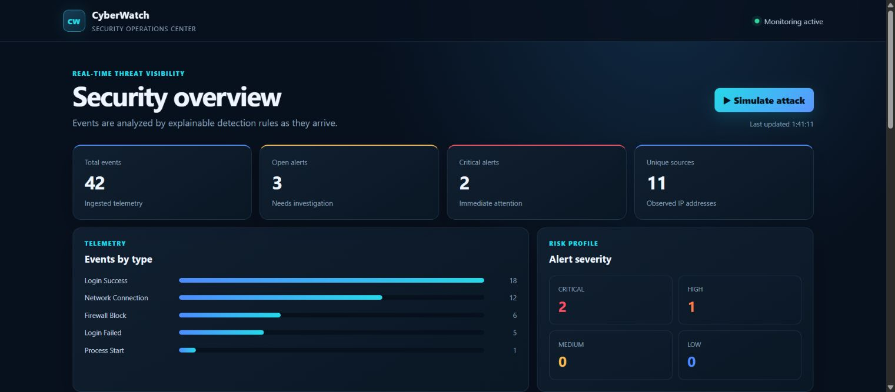
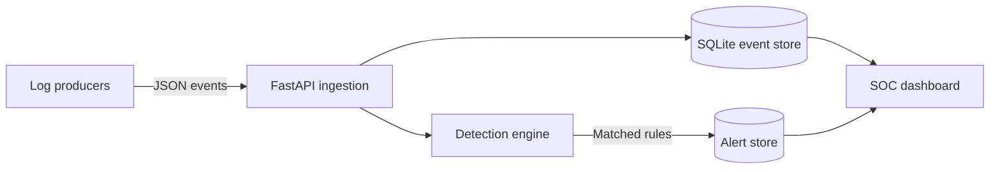

# CyberWatch Mini-SIEM

[](https://github.com/omerbenguigui/CyberWatch/actions/workflows/ci.yml)
[](https://www.python.org/)
[](https://fastapi.tiangolo.com/)

CyberWatch is a small security event monitoring application built with Python, FastAPI and
SQLite. Send it structured events, inspect the rules that produced an alert, and record an
investigation in the dashboard. The bundled scenarios generate synthetic telemetry, so the
local demo can be explored without running attacks or collecting real logs.

## Demo

[](https://github.com/user-attachments/assets/d09fdb44-8cab-420d-8a34-ad34370ec333)

**[Watch the 32-second walkthrough](https://github.com/user-attachments/assets/d09fdb44-8cab-420d-8a34-ad34370ec333)** — press Play to start; pause or seek to inspect a step.

The captioned walkthrough follows a real local demo session: dashboard overview,
synthetic brute-force events, detection evidence, an analyst note and resolution.
Each step stays on screen long enough to read. No audio is required.

https://github.com/user-attachments/assets/d09fdb44-8cab-420d-8a34-ad34370ec333

[View the animated version](docs/images/cyberwatch-demo.gif) ·
[View the dashboard screenshot](docs/images/dashboard.png)

## Try the workflow

Start the local application using the instructions below, then:

1. Open the dashboard and choose one of the simulation scenarios.
2. Inspect the resulting alert: source, rule, detection evidence and mapped technique.
3. Change its status to **Investigating**, add an analyst note, then mark it **Resolved**.
4. Filter the alert list by severity or status to review the result.

The initial seed creates 42 events and three alerts in an empty database. Interactive
simulations deliberately add new events; they are separate from that one-time seed.

## Features

- FastAPI REST API with automatic OpenAPI documentation
- Real-time, rule-based detection for brute force, port scanning, and suspicious processes
- One-click safe attack simulations that generate synthetic telemetry only
- MITRE ATT&CK mappings for every bundled detection rule
- Interactive alert investigation with status transitions and analyst notes
- SQLite persistence with indexed, parameterized queries
- API-key protection for ingestion and alert-triage operations
- Responsive SOC dashboard with event and severity visualizations
- Batch event ingestion and alert deduplication cooldowns
- Synthetic demo-data generator (no real attack traffic required)
- Automated tests, coverage reporting, linting, security scanning and GitHub Actions CI

## Architecture



The detection engine intentionally uses transparent rules rather than a black-box score. Each
alert includes a rule ID, evidence, source, severity, and human-readable explanation.

## Detection rules

[MITRE ATT&CK](https://attack.mitre.org/) is the knowledge base used to label the techniques
illustrated by the detection rules. **ATT&CK** is its official spelling. These mappings provide
investigation context; they do not mean the application covers the full framework.

| Rule ID | Detection | Trigger | Severity | MITRE ATT&CK |
| --- | --- | --- | --- | --- |
| `CW-AUTH-001` | Brute-force attempt | 5 failed logins from one IP in 5 minutes | High | [`T1110` Brute Force](https://attack.mitre.org/techniques/T1110/) |
| `CW-NET-001` | Port scan | 10 distinct destination ports from one IP in 2 minutes | Critical | [`T1046` Network Service Discovery](https://attack.mitre.org/techniques/T1046/) |
| `CW-ENDPOINT-001` | Suspicious process | Command line matches risky script-execution indicators | Critical | [`T1059.001` PowerShell](https://attack.mitre.org/techniques/T1059/001/) |

Repeated alerts for the same rule and source are suppressed for ten minutes to reduce analyst
fatigue.

## Quick start

### Windows: one click

Install Python 3.11+ with the Python launcher or **Add Python to PATH**, then double-click
[`start_windows.bat`](start_windows.bat). It creates `.venv` if needed, installs the project
runtime dependencies, seeds an empty database, starts the server, and opens the dashboard in
the default browser automatically.
Internet access is required to install dependencies. Keep the console open; press Ctrl+C to stop.
If setup fails, the console stays open with the error. Existing environment variables are respected.
If port 8000 is busy, set `CYBERWATCH_PORT` to another port before running the launcher.

Demo generation is atomic and only runs when the database has no events. Running it again,
including two concurrent launches, preserves existing events and alerts instead of adding
another 42 events. It does not delete duplicates that were already present.

### Local Python setup

```bash
python -m venv .venv
```

Activate the virtual environment:

```bash
# Windows PowerShell
.venv\Scripts\Activate.ps1

# macOS/Linux
source .venv/bin/activate
```

Install and run:

```bash
pip install -e ".[dev]"
python -m scripts.generate_demo_data
uvicorn app.main:app --reload
```

Open:

- Dashboard: <http://localhost:8000>
- API docs: <http://localhost:8000/docs>
- Health check: <http://localhost:8000/api/health>

### Docker

```bash
export CYBERWATCH_API_KEY="replace-with-a-long-random-value"
docker compose up --build
```

On Windows PowerShell, set the variable with:

```powershell
$env:CYBERWATCH_API_KEY="replace-with-a-long-random-value"
docker compose up --build
```

## Configuration

Settings are read from environment variables; the default local demo needs no configuration.

| Variable | Default | Purpose |
| --- | --- | --- |
| `CYBERWATCH_ENV` | `development` | Set to `production` to disable synthetic simulations and require a non-default API key |
| `CYBERWATCH_DATABASE_PATH` | `data/cyberwatch.db` | SQLite file location |
| `CYBERWATCH_API_KEY` | `dev-key-change-me` | Key for ingestion and alert updates |
| `CYBERWATCH_ALLOWED_ORIGINS` | `http://localhost:8000` | Comma-separated allowed browser origins |
| `CYBERWATCH_PORT` | `8000` | Port used by the Windows launcher |

The browser investigation form uses the development key. With a custom key, use the API for
updates; the current frontend does not provide a key-entry or user-login screen.

## Ingest an event

The development API key is `dev-key-change-me`. It must be overridden in production.

```bash
curl -X POST http://localhost:8000/api/events \
  -H "Content-Type: application/json" \
  -H "X-API-Key: dev-key-change-me" \
  -d '{
    "event_type": "login_failed",
    "source_ip": "203.0.113.42",
    "destination_ip": "10.0.0.5",
    "destination_port": 22,
    "username": "admin",
    "message": "Invalid password"
  }'
```

Supported event types are `login_success`, `login_failed`, `network_connection`,
`process_start`, `file_access`, and `firewall_block`.

## API overview

| Method | Endpoint | Protected | Purpose |
| --- | --- | --- | --- |
| `GET` | `/api/health` | No | Service health |
| `POST` | `/api/events` | API key | Ingest one event |
| `POST` | `/api/events/batch` | API key | Ingest up to 500 events |
| `GET` | `/api/events` | No | Search recent events |
| `GET` | `/api/alerts` | No | Filter recent alerts |
| `PATCH` | `/api/alerts/{id}/acknowledge` | API key | Triage an alert |
| `PATCH` | `/api/alerts/{id}` | API key | Update status and analyst note |
| `GET` | `/api/dashboard/summary` | No | Aggregated dashboard metrics |
| `POST` | `/api/demo/simulate/{scenario}` | Disabled in production | Generate safe synthetic attack telemetry |
| `GET` | `/api/demo/status` | No | Check whether simulations are enabled |

## Tests and quality checks

```bash
ruff check .
bandit -q -r app scripts
pytest
node --check app/static/app.js
python -m build
```

The test suite covers detection thresholds, time windows, duplicate suppression, authentication,
event ingestion, safe attack simulations, alert investigation updates, and dashboard aggregation.

## Code guide

| Path | Responsibility |
| --- | --- |
| [app/main.py](app/main.py) | Routes, API-key checks and application startup |
| [app/models.py](app/models.py) | Event, alert and request schemas |
| [app/database.py](app/database.py) | SQLite queries, transactions and alert persistence |
| [app/detection.py](app/detection.py) | Detection thresholds, evidence and cooldowns |
| [app/simulation.py](app/simulation.py) | Synthetic scenarios for the interactive demo |
| [app/static/](app/static/) | Dashboard HTML, CSS and JavaScript |
| [scripts/generate_demo_data.py](scripts/generate_demo_data.py) | Atomic seed for an empty database |
| [tests/](tests/) | API, detection and demo regression tests |

## Design choices

FastAPI keeps request validation and API documentation close to the endpoint definitions.
SQLite makes the local demo easy to run without a separate database service. The detection
rules are explicit Python functions, with thresholds and evidence that can be inspected in
the code. The frontend uses plain JavaScript and polls the API every ten seconds.

## Security decisions

- Ingestion and alert-update endpoints use a constant-time API-key comparison.
- SQL statements use parameters rather than string interpolation for user-controlled values.
- Production startup fails when the default development API key is still configured.
- Interactive attack simulations are disabled automatically in production mode.
- Batch size and field lengths are bounded to reduce accidental resource exhaustion.
- The Docker container runs as an unprivileged user.
- The CI workflow has read-only repository permissions.

This project is an educational defensive-security tool. The bundled generator creates only
synthetic events and does not perform network scanning or exploitation.

## Current scope

CyberWatch is an educational application, not a production SIEM. It accepts structured JSON;
it does not collect endpoint logs, syslog or packet captures automatically. Read endpoints and
the dashboard are public, and there are no user accounts, roles or rate limits. The simulation
endpoint is unauthenticated outside production mode, so keep the development server local.

The rules demonstrate three patterns and can produce false positives. SQLite and synchronous
detection are suited to this demo's scale; no throughput or production availability guarantees
are claimed. Analyst notes represent the current note, not an immutable audit history.

## Possible extensions

- PostgreSQL and asynchronous event queues for higher throughput
- User accounts with role-based access control
- Sigma-compatible custom detection rules
- Email or Slack notifications
- PCAP and syslog collectors
- Multi-user case ownership and investigation timelines

## Author

**Omer Benguigui** — Computer Science student at Holon Institute of Technology.

[More projects](https://github.com/omerbenguigui)
